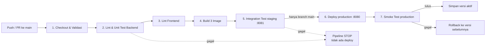

# Sistem Data Mahasiswa — Full Stack 3 Container + CI/CD

Website CRUD data mahasiswa (tambah, lihat, cari, edit, hapus) yang berjalan di **3 container Docker**
dan dirilis lewat **pipeline CI/CD** sampai ke **server lokal** (`http://localhost:8080`).

```
Browser ──► [1] frontend (Nginx + HTML/CSS/JS) ──/api──► [2] backend (Node.js Express) ──SQL──► [3] db (PostgreSQL)
            port 8080 (satu-satunya yang terbuka)        port 3000 (internal)               port 5432 (internal)
```

---

## 1. Struktur Proyek

```
sistem-mahasiswa/
├── frontend/                 # CONTAINER 1 - tampilan
│   ├── public/index.html     #   halaman utama (form + tabel)
│   ├── public/css/style.css
│   ├── public/js/app.js      #   memanggil REST API lewat fetch()
│   ├── nginx.conf            #   web server + reverse proxy /api -> backend
│   └── Dockerfile            #   stage lint (HTMLHint) + stage runtime (nginx)
├── backend/                  # CONTAINER 2 - logika & API
│   ├── src/server.js         #   start server, koneksi pool PostgreSQL, graceful shutdown
│   ├── src/app.js            #   route REST + validasi input + error handling
│   ├── src/repo.js           #   query SQL (parameterized)
│   ├── test/app.test.js      #   13 unit test (node:test)
│   └── Dockerfile            #   stage deps -> test (lint+test) -> runtime
├── db/                       # CONTAINER 3 - penyimpanan data
│   ├── init/001_schema.sql   #   tabel mahasiswa + data awal
│   └── Dockerfile
├── compose.yaml              # definisi 3 service, 2 network, 1 volume
├── pipeline.ps1              # pipeline CI/CD (dijalankan lokal & oleh GitHub Actions)
├── scripts/smoke-test.ps1    # integration/smoke test end-to-end
├── .github/workflows/ci-cd.yml  # definisi CI/CD di GitHub Actions
└── .env.example
```

---

## 2. Penjelasan Container

| | **frontend** | **backend** | **db** |
|---|---|---|---|
| Fungsi | Menampilkan tampilan dasar (HTML) & meneruskan request `/api` | REST API: validasi, logika CRUD | Menyimpan data secara permanen |
| Base image | `nginx:1.27-alpine` | `node:22-alpine` | `postgres:16-alpine` |
| Image hasil build | `mhs-frontend:<versi>` | `mhs-backend:<versi>` | `mhs-db:<versi>` |
| Port | **8080 → 80** (dibuka ke host) | 3000 (hanya internal) | 5432 (hanya internal) |
| Network | `frontend-net` | `frontend-net` + `backend-net` | `backend-net` (internal) |
| Health check | `wget http://127.0.0.1/` | `wget /api/health` (ikut cek DB) | `pg_isready -h 127.0.0.1` |
| Start setelah | backend *healthy* | db *healthy* | — |
| Data | stateless | stateless | volume `db-data` (persisten) |

### 2.1 Container `frontend` (Nginx + HTML)
- Menyajikan `index.html`, `style.css`, `app.js` sebagai file statis.
- **Reverse proxy**: request ke `/api/...` diteruskan ke `http://backend:3000`. Browser hanya bicara
  ke satu alamat, jadi tidak perlu CORS dan backend tidak perlu dibuka ke luar.
- Memakai DNS internal Docker (`resolver 127.0.0.11`) supaya alamat backend dicari ulang saat
  container backend diganti ketika deploy.
- Menambahkan security header (`X-Content-Type-Options`, `X-Frame-Options`, `Referrer-Policy`).
- Data dari pengguna ditampilkan dengan `textContent` (bukan `innerHTML`) sehingga aman dari XSS.

### 2.2 Container `backend` (Node.js + Express)
| Method | Endpoint | Keterangan |
|---|---|---|
| GET | `/api/health` | status backend + database + versi aplikasi (200 / 503) |
| GET | `/api/mahasiswa` | daftar semua mahasiswa |
| GET | `/api/mahasiswa/:id` | detail (404 jika tidak ada) |
| POST | `/api/mahasiswa` | tambah (201; 400 data invalid; 409 NIM duplikat) |
| PUT | `/api/mahasiswa/:id` | ubah |
| DELETE | `/api/mahasiswa/:id` | hapus (204) |

- Validasi: NIM 5–15 digit, nama & jurusan wajib (maks. 100 karakter), angkatan 2000–2100.
- Query SQL selalu memakai parameter (`$1, $2`) → aman dari SQL injection.
- Berjalan sebagai user **non-root** (`node`); image produksi hanya berisi dependency runtime.
- Menunggu database siap (retry) dan mematikan diri dengan rapi saat menerima `SIGTERM`.

### 2.3 Container `db` (PostgreSQL)
- Saat volume masih kosong, `init/001_schema.sql` membuat tabel `mahasiswa`
  (NIM `UNIQUE`, `CHECK` angkatan) dan mengisi 3 data contoh.
- Data disimpan di **named volume** `db-data`, sehingga data **tidak hilang** saat container
  diganti versi baru (sudah dibuktikan saat verifikasi, lihat bagian 5).
- Berada di network `backend-net` yang `internal: true`: hanya backend yang bisa menjangkaunya,
  dan database tidak punya akses internet.

---

## 3. Alur CI/CD

Pipeline ditulis sekali di `pipeline.ps1` dan dipakai di dua tempat:
1. **Lokal** – jalankan langsung `.\pipeline.ps1` (cara yang dipakai untuk pengujian ini).
2. **GitHub Actions** – `.github/workflows/ci-cd.yml` memanggil script yang sama:
   job `ci` di runner GitHub (`ubuntu-latest`), job `cd` di **self-hosted runner** = server lokal.



### Bagian CI (Continuous Integration)
| # | Stage | Yang dilakukan | Gagal jika |
|---|---|---|---|
| 1 | Checkout & Validasi | cek file wajib, cek Docker, `docker compose config` | file hilang / YAML salah |
| 2 | Lint & Unit Test Backend | `docker build --target test` → ESLint + 13 unit test + coverage | ada error lint / test gagal |
| 3 | Lint Frontend | `docker build --target lint` → HTMLHint + `node --check app.js` | HTML/JS tidak valid |
| 4 | Build Image | `docker compose build` → `mhs-frontend`, `mhs-backend`, `mhs-db` bertag versi (mis. `1.0.2`) | build error |
| 5 | Integration Test | jalankan 3 container di proyek `mhs-staging` (port 8081, password acak), tunggu *healthy*, smoke test 8 skenario, lalu **hapus** staging + volumenya | ada skenario gagal |

### Bagian CD (Continuous Deployment ke server lokal)
| # | Stage | Yang dilakukan |
|---|---|---|
| 6 | Deploy | `docker compose -p mhs-prod up -d --wait` memakai **image yang sama** yang sudah lulus test. Volume database production dipertahankan. |
| 7 | Smoke Test Production | 8 skenario end-to-end di `http://localhost:8080`, termasuk cek versi yang berjalan = versi yang di-deploy |
| – | Rollback (otomatis) | Jika deploy/smoke test gagal: container dikembalikan ke versi sebelumnya (dicatat di `.deploy/current-version`), lalu diverifikasi via `/api/health` |

**Skenario smoke test:** halaman HTML + security header · aset CSS/JS · health backend & DB ·
data seed terbaca · CREATE (201) · duplikat (409) & invalid (400) · READ & UPDATE · DELETE (204 → 404).

**Konsep penting yang diterapkan**
- *Build once, deploy many*: image yang dites di staging adalah image yang sama persis yang dideploy.
- *Quality gate*: lint/test dijalankan di dalam Docker build, sehingga host tidak perlu Node.js.
- *Versioning*: setiap run mendapat versi `1.0.<nomor build>`; terlihat di footer website & `/api/health`.
- *Zero manual step*: env production (password DB acak) dibuat otomatis saat deploy pertama.
- *Jejak audit*: log tiap run di `.pipeline/run-<versi>.log`, ringkasan di `.pipeline/last-run.json`,
  riwayat deploy di `.deploy/history.log`.

---

## 4. Cara Menjalankan

Prasyarat: Docker Desktop (sudah termasuk Docker Compose). Node.js **tidak** perlu dipasang.

```bash
cd D:\DevOps\sistem-mahasiswa
```

Jalankan CI + CD lengkap:
```bash
powershell -ExecutionPolicy Bypass -File .\pipeline.ps1
```

Opsi lain:
```bash
powershell -ExecutionPolicy Bypass -File .\pipeline.ps1 -Mode ci
```
```bash
powershell -ExecutionPolicy Bypass -File .\pipeline.ps1 -Mode cd
```
```bash
powershell -ExecutionPolicy Bypass -File .\pipeline.ps1 -Mode cd -SimulateDeployFailure
```
(`-SimulateDeployFailure` hanya untuk mendemokan rollback.)

Perintah berguna:
```bash
docker compose -p mhs-prod --env-file .deploy/prod.env ps
```
```bash
docker compose -p mhs-prod --env-file .deploy/prod.env logs -f backend
```
```bash
docker exec -it mhs-prod-db-1 psql -U mhs -d mahasiswa -c "SELECT * FROM mahasiswa;"
```

Mematikan production (data tetap aman di volume; tambahkan `-v` untuk menghapus data juga):
```bash
docker compose -p mhs-prod --env-file .deploy/prod.env down
```

### CI/CD di GitHub Actions (sudah aktif)
- Repository (private): https://github.com/Fielbert777/sistem-mahasiswa
- Self-hosted runner **`laptop-lokal`** terpasang di `D:\actions-runner` (label `self-hosted, Windows, X64, docker`).
- Setiap push ke `main`: job `ci` jalan di server GitHub (`ubuntu-latest`), lalu job `cd`
  jalan di runner laptop ini dan men-deploy ke `http://localhost:8080`. Pull request hanya menjalankan CI.
- Versi dari GitHub = `1.1.<nomor run>` (versi `1.0.x` = run pipeline lokal).
- State deploy runner (env production, versi aktif, riwayat) ada di
  `D:\actions-runner\_work\sistem-mahasiswa\mhs-deploy`.
- Log tiap run bisa diunduh dari halaman run sebagai artifact `ci-log-<versi>` / `cd-log-<versi>`.

Menyalakan runner (harus menyala agar job CD bisa jalan; hentikan dengan Ctrl+C):
```bash
powershell -NoProfile -ExecutionPolicy Bypass -File D:\actions-runner\start-runner.ps1
```

Memantau run terakhir dari terminal:
```bash
gh run watch
```

---

## 5. Hasil Verifikasi (30 Oktober 2026)

| Pengujian | Hasil |
|---|---|
| Pipeline lengkap v1.0.1 (7 stage) | ✅ semua SUCCESS, exit code 0 |
| ESLint + 13 unit test backend | ✅ 13/13 lulus, coverage baris 100%, branch 94,85% |
| HTMLHint + cek sintaks JS | ✅ tidak ada error |
| Integration test staging (8 skenario) | ✅ 8/8 PASS, staging dibersihkan |
| Deploy production + smoke test (8 skenario) | ✅ 8/8 PASS, 3 container *healthy* |
| Upgrade v1.0.1 → v1.0.2 | ✅ versi berganti, **data yang dibuat sebelum upgrade tetap ada** |
| Rollback (`-SimulateDeployFailure`, v1.0.3) | ✅ otomatis kembali ke v1.0.2, pipeline exit code 1 |
| Quality gate (bug sengaja ditanam di salinan kode) | ✅ unit test gagal → pipeline berhenti di stage 2, production tidak tersentuh |
| Isolasi jaringan | ✅ hanya port 8080 terbuka; frontend **tidak** bisa menjangkau db; backend bisa; db tanpa internet |
| Backend berjalan sebagai non-root | ✅ user `node` |
| Workflow GitHub Actions | ✅ lolos `actionlint` (belum dijalankan di GitHub sungguhan) |
| Uji manual di browser | ✅ tampilan tampil, status "online", tambah data via form berhasil |

### Hasil di GitHub Actions
| Run | Job CI (ubuntu-latest) | Job CD (self-hosted `laptop-lokal`) |
|---|---|---|
| #1 → v1.1.1 | ✅ 13/13 unit test, lint lulus, 8/8 integration test | ✅ deploy 1.0.2 → 1.1.1, 8/8 smoke test, data lama tetap ada |

### Catatan & batasan
- Job CD hanya bisa jalan saat runner di laptop menyala (lihat perintah di atas); jika mati,
  job CD berstatus *queued* sampai runner dinyalakan.
- Smoke test production membuat lalu menghapus 1 data uji (NIM berawalan `9`) setiap deploy.
- Image versi lama tidak dihapus otomatis; bersihkan sesekali dengan `docker image prune`
  atau `docker image rm mhs-backend:<versi-lama>`.
- Deploy memakai `docker compose up` biasa, jadi ada jeda singkat (beberapa detik) saat container
  diganti — wajar untuk server lokal satu mesin.
